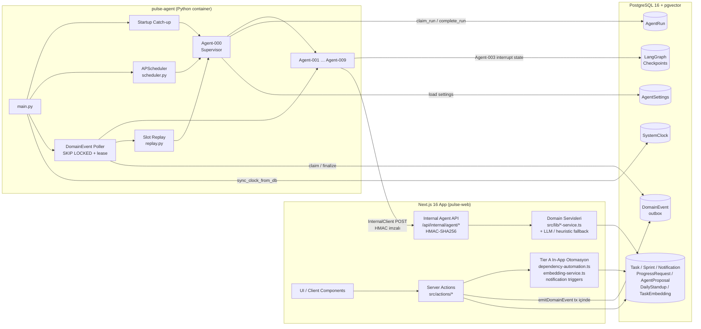
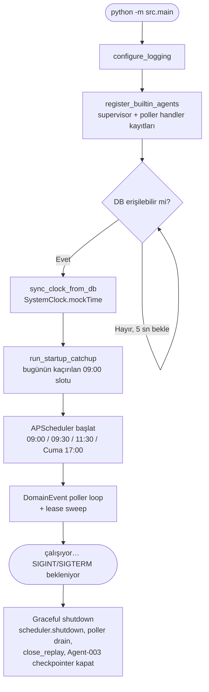
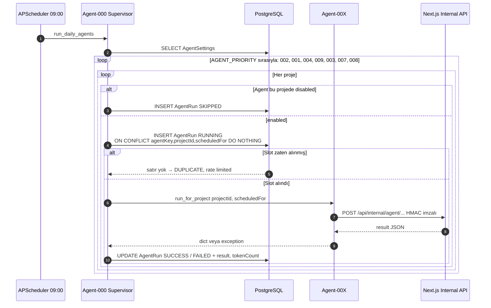
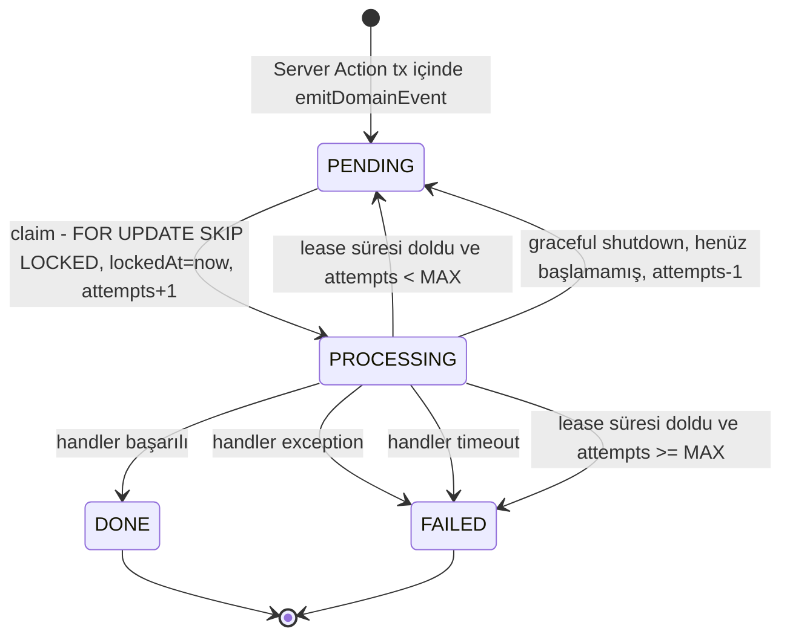
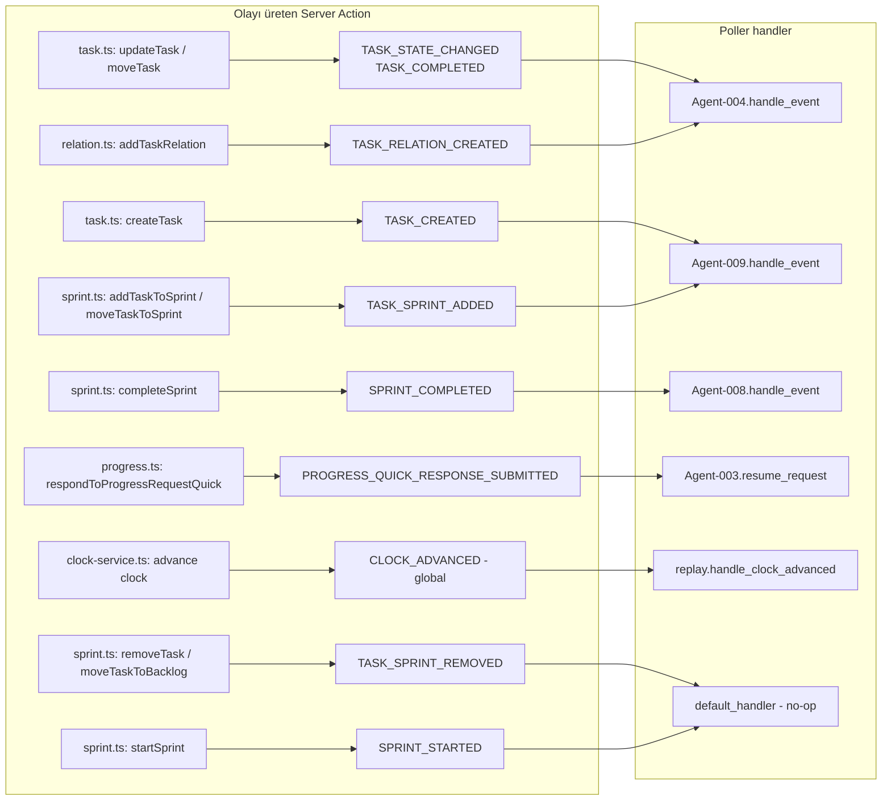
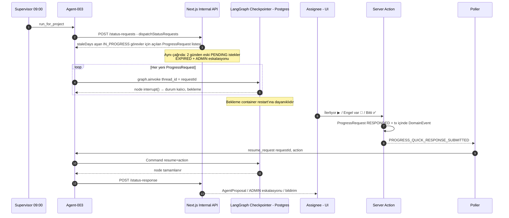
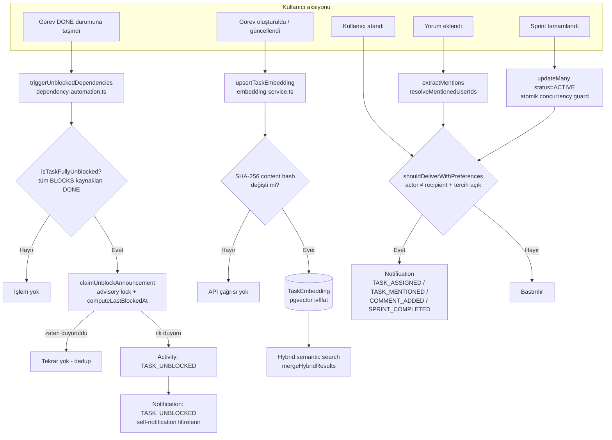
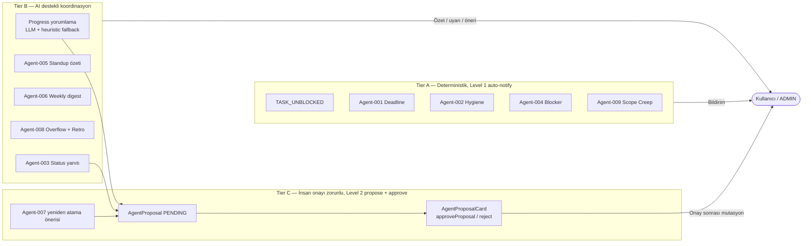
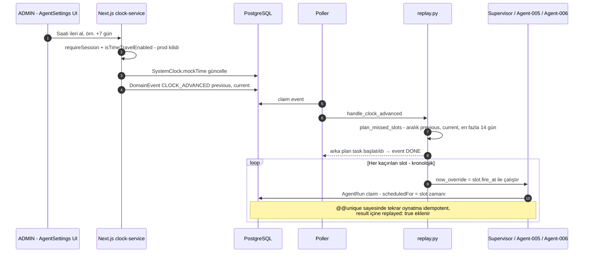

# Pulse — Agent Yapısı ve Otomasyon Diyagramları

> Kaynak: `agent/src/` (Python LangGraph container), `src/app/api/internal/agent/` (HMAC Internal API),
> `src/lib/*-service.ts`, `src/lib/domain-events.ts`, `src/lib/dependency-automation.ts`.
> Tüm diyagramlar Mermaid formatındadır (VS Code Markdown Preview / GitHub'da doğrudan render edilir).

---

## 1. Genel Mimari (3 katman: Next.js ↔ PostgreSQL ↔ pulse-agent)

---

## 2. Agent Kataloğu ve Tetikleyiciler

```mermaid
flowchart TB
    subgraph TRIG["Tetikleyiciler"]
        D09["Günlük 09:00<br/>Supervisor sweep"]
        S0930["Günlük 09:30<br/>standup open"]
        S1130["Günlük 11:30<br/>standup cutoff"]
        F17["Cuma 17:00<br/>weekly digest"]
        EV_TSC["TASK_STATE_CHANGED"]
        EV_TRC["TASK_RELATION_CREATED"]
        EV_TSA["TASK_SPRINT_ADDED"]
        EV_TC["TASK_CREATED"]
        EV_SC["SPRINT_COMPLETED"]
        EV_PQ["PROGRESS_QUICK_RESPONSE_SUBMITTED"]
        EV_CA["CLOCK_ADVANCED"]
    end

    subgraph AG["Agent'lar"]
        A002["Agent-002<br/>Task Hygiene"]
        A001["Agent-001<br/>Deadline Tracker"]
        A004["Agent-004<br/>Blocker Manager"]
        A009["Agent-009<br/>Scope Creep"]
        A003["Agent-003<br/>Status Requester<br/>LangGraph interrupt/resume"]
        A007["Agent-007<br/>Workload Balancer"]
        A008["Agent-008<br/>Sprint Assistant"]
        A005["Agent-005<br/>Async Standup"]
        A006["Agent-006<br/>Weekly Digest"]
        RPL["Slot Replay"]
    end

    subgraph API["Internal API → Next.js Servisi"]
        E_HY["/hygiene-check<br/>dispatchTaskHygieneReport"]
        E_DL["/deadline-check<br/>dispatchDueDateReminders"]
        E_BL["/blocker-check<br/>dispatchBlockerCheck"]
        E_SCP["/scope-creep-check<br/>dispatchScopeCreepCheck"]
        E_SR["/status-requests<br/>dispatchStatusRequests"]
        E_SRS["/status-response"]
        E_WL["/workload-check<br/>dispatchWorkloadCheck"]
        E_SO["/sprint-overflow-check<br/>dispatchSprintOverflowCheck"]
        E_RET["/sprint-retro<br/>dispatchSprintRetro"]
        E_SUO["/standup-open<br/>openTodayStandup"]
        E_SUS["/standup-synthesize<br/>synthesizeStandup"]
        E_WD["/weekly-digest<br/>dispatchWeeklyDigest"]
    end

    D09 -->|"öncelik 1"| A002
    D09 -->|"2"| A001
    D09 -->|"3"| A004
    D09 -->|"4"| A009
    D09 -->|"5"| A003
    D09 -->|"6"| A007
    D09 -->|"7"| A008

    EV_TSC --> A004
    EV_TRC --> A004
    EV_TSA --> A009
    EV_TC --> A009
    EV_SC --> A008
    EV_PQ -->|"resume"| A003
    EV_CA --> RPL

    S0930 --> A005
    S1130 --> A005
    F17 --> A006

    A002 --> E_HY
    A001 --> E_DL
    A004 --> E_BL
    A009 --> E_SCP
    A003 --> E_SR
    A003 --> E_SRS
    A007 --> E_WL
    A008 --> E_SO
    A008 --> E_RET
    A005 --> E_SUO
    A005 --> E_SUS
    A006 --> E_WD

    RPL -.->|"kaçırılan slotları<br/>now_override ile"| D09
    RPL -.-> S0930
    RPL -.-> S1130
    RPL -.-> F17
```

| Agent | Tetikleyici | LLM | Tier | Çıktı |
|---|---|---|---|---|
| 000 Supervisor | 09:00 cron + catch-up | — | — | AgentRun claim, enablement, rate-limit |
| 001 Deadline Tracker | 09:00 | Yok | A | 3/1/0 gün hatırlatma, overdue → ADMIN eskalasyonu |
| 002 Task Hygiene | 09:00 | Yok | A | Atanmamış / tarihsiz / açıklamasız görev raporu |
| 003 Status Requester | 09:00 + `PROGRESS_QUICK_RESPONSE_SUBMITTED` | Yok | B/C | ProgressRequest, interrupt/resume, 2 gün timeout eskalasyonu |
| 004 Blocker Manager | 09:00 + `TASK_STATE_CHANGED`, `TASK_RELATION_CREATED` | Yok | A | Stale/overdue blocker uyarısı |
| 005 Async Standup | 09:30 / 11:30 (kendi cron'u) | Var (server-side) + heuristic | B | DailyStandup, özet bildirimi |
| 006 Weekly Digest | Cuma 17:00 (kendi cron'u) | Var (server-side) + heuristic | B | Sprint sağlığı / velocity özeti |
| 007 Workload Balancer | 09:00 | Var (server-side) | C | PENDING AgentProposal (yeniden atama) |
| 008 Sprint Assistant | 09:00 + `SPRINT_COMPLETED` | Var (retro, server-side) | B | Overflow uyarısı, retro taslağı |
| 009 Scope Creep | 09:00 + `TASK_SPRINT_ADDED`, `TASK_CREATED` | Yok | A | Sprint kapsam büyümesi uyarısı |

---

## 3. Container Başlangıç Akışı (`main.py`)

---

## 4. Supervisor Günlük Çalıştırma (Agent-000)

---

## 5. DomainEvent Outbox Yaşam Döngüsü (Poller)

---

## 6. Agent-003 Status Requester — LangGraph interrupt / resume (Human-in-the-loop)

---

## 7. Tier A — Next.js İçi Deterministik Otomasyonlar (Container'sız)

---

## 8. Otomasyon Seviyeleri (ADR-028 — Autonomy Tiers)

---

## 9. Slot Replay — Time Travel (ADR-036)

