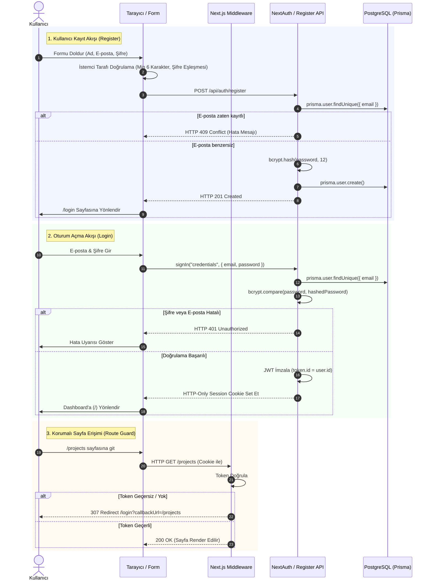

# Faz 1.03 — Kimlik Doğrulama (Auth) & Oturum Yönetimi: Teknik Rapor

> **Proje:** Pulse Project Manager  
> **Faz:** 1.03 (Kayıt, Giriş, NextAuth.js & Güvenlik Mimarisi)  
> **Tarih:** 17 Eylül 2026  
> **Durum:** ✅ Tamamlandı & Doğrulandı

---

## 1. Yönetici Özeti (Executive Summary)

Faz 1.03 kapsamında, Pulse uygulamasına **NextAuth.js v4** tabanlı, e-posta ve şifreye dayalı güvenli kimlik doğrulama altyapısı entegre edilmiştir.

Bu fazın temel amacı; sonraki adımlarda geliştirilecek olan proje sahipliği, üyelikler, görev atamaları ve yorum mekanizmalarının ihtiyaç duyduğu kullanıcı kimliğini (`session.user.id`) oturum boyunca güvenli ve kesintisiz biçimde sunmaktır.

---

## 2. Kimlik Doğrulama ve Oturum Akışı (Sequence Diagram)

Aşağıdaki diyagram, kayıt olma ve giriş yapma süreçlerinin istemci, sunucu ve veritabanı arasındaki adım adım akışını göstermektedir:



---

## 3. Sistem Mimarisi ve Modüller

### 3.1 NextAuth Konfigürasyonu (`src/lib/auth.ts`)
Sistemin kimlik doğrulama beyni bu dosyadır:
- **Provider:** `CredentialsProvider` kullanılarak e-posta ve şifre doğrulaması yapılır.
- **Doğrulama (`authorize`):**
  - İstek parametrelerinin varlığı kontrol edilir.
  - Veritabanından kullanıcı çekilir (`prisma.user.findUnique`).
  - `bcrypt.compare` ile girilen parola ile veritabanındaki hash karşılaştırılır.
  - Eşleşirse `{ id, email, name }` nesnesi döndürülür; eşleşmezse `null` döner.
- **Oturum Stratejisi:** `strategy: "jwt"` seçilmiştir. Veritabanına her istekte oturum sorgusu atmak yerine, kriptografik olarak imzalı JWT kullanılır.
- **Özelleştirilmiş Sayfalar:** `pages: { signIn: "/login" }` ile NextAuth'un varsayılan ham arayüzü yerine özel tasarlanmış modern giriş sayfasına yönlendirilir.

```typescript
callbacks: {
  async jwt({ token, user }) {
    if (user) {
      token.id = user.id; // İlk girişte user.id token'a yazılır
    }
    return token;
  },
  async session({ session, token }) {
    if (session.user) {
      session.user.id = token.id as string; // Her oturum isteğinde session.user.id hazır gelir
    }
    return session;
  },
}
```

---

### 3.2 Tip Genişletmesi (`src/types/next-auth.d.ts`)
NextAuth'un varsayılan `Session` ve `JWT` tiplerinde `id` alanı bulunmaz. TypeScript'in strict modunda tip hatalarını önlemek ve IDE oto-tamamlamasını sağlamak için TypeScript modül artırımı (module augmentation) uygulanmıştır:

```typescript
import type { DefaultSession } from "next-auth";

declare module "next-auth" {
  interface Session {
    user: {
      id: string;
    } & DefaultSession["user"];
  }
}

declare module "next-auth/jwt" {
  interface JWT {
    id: string;
  }
}
```

---

### 3.3 Güvenli Kayıt Endpoint'i (`src/app/api/auth/register/route.ts`)
Yeni kullanıcıların sisteme kaydolmasını sağlayan REST uç noktasıdır:
- **Girdi Kontrolü:** `name`, `email` ve `password` alanlarının zorunluluğu (Eksikse `HTTP 400`).
- **Mükerrerlik Kontrolü:** Aynı e-posta adresiyle daha önce kayıt yapılmışsa `HTTP 409 Conflict`.
- **Şifreleme Maliyeti (Salt Rounds):** `bcrypt.hash(password, 12)` kullanılarak şifreler brute-force saldırılarına karşı yüksek korumayla hash'lenir.
- **Cevap:** Parola hash'i asla istemciye dönülmez; yalnızca `{ id, email, name }` ile `HTTP 201 Created` döndürülür.

---

### 3.4 Rota Koruması ve Güvenlik Duvarı (`src/middleware.ts`)
Next.js Edge Middleware altyapısı kullanılarak, uygulamanın korumalı sayfalarına izinsiz erişim engellenmiştir:

```typescript
import { withAuth } from "next-auth/middleware";

export default withAuth({
  pages: {
    signIn: "/login",
  },
});

export const config = {
  matcher: [
    "/((?!api/auth|login|register|_next/static|_next/image|favicon.ico).*)",
  ],
};
```

- **Açık (Public) Rotalar:** `/login`, `/register`, `/api/auth/*` ve statik kaynaklar (`_next/*`, `favicon.ico`).
- **Korumalı (Private) Rotalar:** Yukarıdakiler dışındaki tüm sayfalar (`/`, `/projects/*` vb.). Giriş yapmamış kullanıcı otomatik olarak `/login?callbackUrl=...` adresine 307 yönlendirmesiyle gönderilir.

---

### 3.5 Kullanıcı Arayüzü ve Form Katmanı

#### 1. Auth Layout (`src/app/(auth)/layout.tsx`)
- Sidebar veya üst navigasyon çubuğu içermez.
- Sayfanın tam ortasında yer alan temiz, odaklanmış bir kart tasarımı sunar.

#### 2. Giriş Formu (`src/components/auth/login-form.tsx`)
- E-posta ve şifre inputları.
- Hatalı girişte kırmızı alert kutusu ile net hata bildirimi.
- Gönderim sırasında butonu devre dışı bırakan yükleniyor durumu (spinner).
- Kayıt sayfasına geçiş bağlantısı.

#### 3. Kayıt Formu (`src/components/auth/register-form.tsx`)
- Ad, e-posta, şifre ve şifre tekrarı alanları.
- İstemci tarafı doğrulama: geçerli e-posta regex'i, minimum 6 karakter şifre uzunluğu ve şifrelerin birebir eşleşmesi.
- Başarılı kayıt sonrasında otomatik olarak `/login` sayfasına yönlendirme.

#### 4. İstemci Sağlayıcısı (`src/components/providers.tsx`)
- Kök `layout.tsx` dosyasında tüm uygulamayı NextAuth `SessionProvider` ile sarar. Böylece React Client Component'lerinde `useSession()` hook'u ile anlık kullanıcı bilgisi çekilebilir.

---

## 4. Alınan Mimari Kararlar ve Değerlendirmeler

| Karar | Seçilen Yaklaşım | Alternatif | Tercih Nedeni |
|---|---|---|---|
| **Oturum Saklama Stratejisi** | JWT (Stateless) | Database Sessions | Her istekte veritabanına sorgu atmayarak gecikmeyi (latency) düşürmek ve veritabanı yükünü hafifletmek. |
| **Şifreleme Kütüphanesi** | `bcryptjs` | Native `bcrypt` | `bcrypt` C++ derleyicisi (node-gyp/Python) gerektirir ve Windows geliştirme ortamlarında sıklıkla hata verir. `bcryptjs` saf JavaScript olduğundan %100 taşınabilirdir. |
| **Kayıt Yöntemi** | Ayrı API Route (`/api/auth/register`) | Server Action | Standart HTTP durum kodları (`201`, `409`, `400`) döndürebilmek ve istemci form validasyonuyla RESTful ayrımı korumak. |
| **OAuth (Sosyal Giriş)** | Kapsam Dışı (Yalnızca Credentials) | Google / GitHub Auth | MVP (Faz 1) aşamasında harici API anahtarı ve callback URL bağımlılığı olmadan yerel çalışabilirlik sağlamak. |

---

## 5. Güvenlik Değerlendirmesi

1. **Parola Güvenliği:** Parolalar veritabanında asla düz metin (plain text) saklanmaz; 12 salt round ile tek yönlü hash'lenir.
2. **CSRF Koruması:** NextAuth oturum açma ve geri çağırma isteklerinde otomatik CSRF token doğrulaması uygular.
3. **Session Güvenliği:** Oturum çerezi `HttpOnly`, `SameSite=Lax` bayraklarıyla korunur; istemci tarafı JavaScript betiklerinin (XSS) çereze doğrudan erişmesi engellenir.
4. **Zamanlama Saldırısı Koruması:** E-posta bulunamasa dahi NextAuth varsayılan olarak zamanlama saldırılarına (timing attacks) karşı standart gecikme payı uygular.

---

## 6. Kabul Kriterleri ve Doğrulama Matrisi

| No | Kabul Kriteri | Durum | Doğrulama Yöntemi |
|:--:|---|:---:|---|
| 1 | `/register` sayfasında yeni kullanıcı oluşturulabiliyor | ✅ | Playwright ve curl ile HTTP 201 doğrulandı |
| 2 | Aynı e-posta ile ikinci kayıtta hata veriliyor | ✅ | HTTP 409 Conflict alındığı teyit edildi |
| 3 | `/login` sayfasında doğru bilgilerle giriş yapılabiliyor | ✅ | Credentials callback başarılı, JWT session cookie alındı |
| 4 | Yanlış şifre ile girişte hata mesajı gösteriliyor | ✅ | HTTP 401 ve kullanıcı arayüzünde kırmızı alert doğrulandı |
| 5 | Giriş yapmadan korumalı rotaya gidildiğinde yönlendirme | ✅ | `/projects` isteğinde `/login` sayfasına 307 Redirect alındı |
| 6 | Giriş sonrası ana sayfaya yönlendirme | ✅ | Başarılı girişin ardından `/` sayfasına geçiş sağlandı |

---

## 7. Sonraki Fazlarla (D-I) Entegrasyon

Faz 1.03'de kurulan bu altyapı, sonraki tüm fazların çalışması için zorunlu zemini oluşturmuştur:
- **Faz 1.04 (Proje Yönetimi):** Proje oluşturulurken `ownerId: session.user.id` ataması ve yetkilendirme bu oturumdan beslenmiştir.
- **Faz 1.05-F (Görev ve Atama):** Görevlere üye atama (`TaskAssignee`) ve üyelik kontrolleri bu kullanıcı kayıtlarına dayanmıştır.
- **Faz 1.08 (Yorumlar):** Yorum silme işlemlerinde `comment.authorId === session.user.id` kuralı uygulanarak kullanıcıların yalnızca kendi yorumlarını silmesi bu sayede garanti edilmiştir.

*Rapor Faz 1.03 gereksinimlerine ve üretim kod tabanına uygun olarak hazırlanmıştır.*
