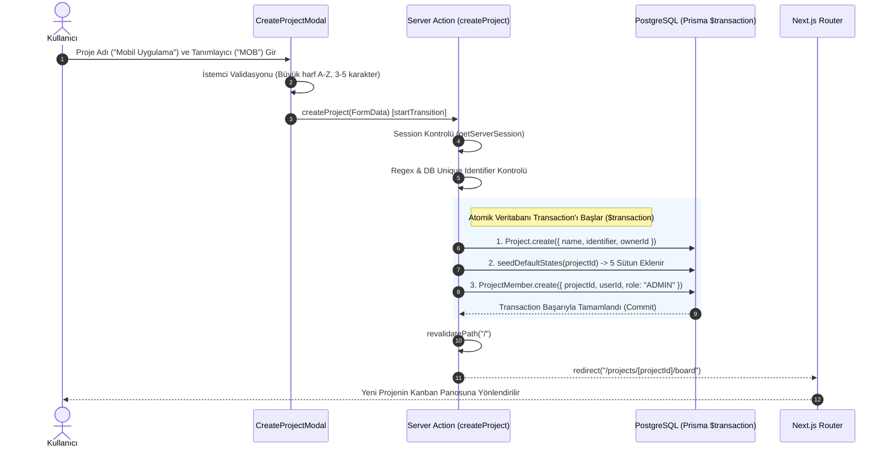

# Faz 1.04 — Proje Yönetimi (CRUD) & Dashboard Mimarisi: Teknik Rapor

> **Proje:** Pulse Project Manager  
> **Faz:** 1.04 (Proje Oluşturma, Listeleme, Silme, Sidebar & Dashboard)  
> **Tarih:** 17 Eylül 2026  
> **Durum:** ✅ Tamamlandı & Doğrulandı

---

## 1. Yönetici Özeti (Executive Summary)

Faz 1.04 kapsamında, Pulse uygulamasına çalışma alanlarının (projelerin) uçtan uca yönetilmesini sağlayan **Proje CRUD** katmanı inşa edilmiştir.

Bu fazın en kritik başarısı; yeni bir proje açıldığında **tek bir atomik veritabanı işlemi (interactive transaction)** içerisinde projenin oluşturulması, 5 varsayılan Kanban sütununun (`Backlog`, `Todo`, `In Progress`, `Done`, `Cancelled`) tohumlanması ve oluşturan kullanıcının `ADMIN` rolüyle projeye bağlanmasıdır.

---

## 2. Proje Oluşturma ve Yaşam Döngüsü Akışı (Sequence Diagram)

Aşağıdaki diyagram, kullanıcının modal üzerinden yeni bir proje oluşturmasından panoya (board) yönlendirilmesine kadar gerçekleşen atomik operasyonu özetlemektedir:



---

## 3. Sunucu Eylemleri Katmanı (`src/actions/project.ts`)

Veri mutasyonları için harici REST API route'ları yazmak yerine, Next.js App Router mimarisinin en güncel standardı olan **Server Actions** tercih edilmiştir.

### 3.1 `createProject(formData: FormData)`
- **Girdi Ayrıştırma ve Normalizasyon:** `identifier` alanı otomatik olarak boşluklardan arındırılır ve `.toUpperCase()` ile büyük harfe çevrilir.
- **Biçim Validasyonu:** `^[A-Z]{3,5}$` regex kuralı ile tanımlayıcının yalnızca 3 ila 5 İngilizce büyük harften oluşması zorunlu kılınır (örn. `PRJ`, `APP`, `TEST`).
- **Tekillik Kontrolü:** Tanımlayıcının veritabanında daha önce alınıp alınmadığı sorgulanır.
- **Atomik Bütünlük (`prisma.$transaction`):**
  1. `Project` kaydı oluşturulur (`ownerId: session.user.id`).
  2. Faz 1.02'de geliştirilen `seedDefaultStates(created.id, tx)` fonksiyonu çağrılarak projeye ait 5 varsayılan sütun aralıklı `sequence` değerleriyle (`15000` - `55000`) basılır.
  3. Projeyi açan kullanıcı `ProjectMember` tablosuna `role: "ADMIN"` olarak eklenir.
- **Yönlendirme:** `revalidatePath("/")` ile dashboard önbelleği temizlenir ve kullanıcı doğrudan `/projects/${project.id}/board` rotasına yönlendirilir.

### 3.2 `updateProject(projectId, data)`
- **Yetkilendirme:** İstek yapan kullanıcının o projenin üyesi (`ProjectMember`) olup olmadığı kontrol edilir. Üye olmayanlar için `HTTP Error` fırlatılır.
- **Kısmi Güncelleme (Partial Update):** Yalnızca gönderilen alanlar (`name` veya `description`) güncellenir.
- **Önbellek Geçersiz kılma:** Hem `/` hem de `/projects/[projectId]/board` yolları yenilenir.

### 3.3 `deleteProject(projectId)`
- **Rol Bazlı Erişim Denetimi (RBAC):** Sadece projedeki rolü `"ADMIN"` olan kullanıcıların silme işlemi yapmasına izin verilir. Düz `"MEMBER"` kullanıcılar projeyi silemez.
- **Cascade Silme:** Proje silindiğinde, Prisma şemasında tanımlı `onDelete: Cascade` kuralı sayesinde projeye ait tüm görevler, etiketler, üyelikler ve durumlar veritabanından atomik olarak temizlenir; arkada artık veri (orphaned rows) kalmaz.
- **Yönlendirme:** Kullanıcı `/` ana sayfasına yönlendirilir.

---

## 4. Kullanıcı Arayüzü ve Sayfa Düzeni (Layout & UI)

```
┌───────────────────────────────────────────────────────────────┐
│                     (main)/layout.tsx                         │
│ ┌──────────────────┐ ┌──────────────────────────────────────┐ │
│ │  Sidebar (256px) │ │  Main Content Area                   │ │
│ │                  │ │                                      │ │
│ │  Pulse           │ │  (main)/page.tsx (Dashboard)         │ │
│ │  [+ Yeni Proje]  │ │  ┌─────────────────────────────────┐ │ │
│ │                  │ │  │ Projeler                        │ │ │
│ │  PROJELER        │ │  │                                 │ │ │
│ │  • PRJ  Demo     │ │  │ [PRJ] Demo Proje                │ │ │
│ │  • MOB  Mobil    │ │  │ 17.09.2026 • 12 görev      [🗑] │ │ │
│ │                  │ │  └─────────────────────────────────┘ │ │
│ │                  │ │                                      │ │
│ │  Kullanıcı [⎋]   │ │                                      │ │
│ └──────────────────┘ └──────────────────────────────────────┘ │
└───────────────────────────────────────────────────────────────┘
```

### 4.1 Ana Yerleşim Düzeni (`src/app/(main)/layout.tsx`)
- Sunucu tarafında `getServerSession` kontrolü yapılır; oturumsuz istekler doğrudan `/login`'e yönlendirilir.
- Kullanıcının üye olduğu tüm projeler (`prisma.projectMember.findMany`) tek sorguda çekilerek `Sidebar` bileşenine aktarılır.

### 4.2 Dashboard (`src/app/(main)/page.tsx`)
- Kullanıcının projelerini kartlar halinde listeler.
- Her kart için ilişkili görev sayısı optimize edilmiş Prisma sorgusuyla (`_count: { select: { tasks: true } }`) veritabanı seviyesinde hesaplanır.
- **Boş Durum (Empty State):** Kullanıcının hiç projesi yoksa `EmptyState` bileşeni devreye girer: *"İlk projenizi oluşturun"* başlığı ve proje oluşturma butonu sunulur.

### 4.3 Kenar Çubuğu (`src/components/layout/sidebar.tsx`)
- Koyu tema (`bg-slate-900`, 256px sabit genişlik).
- Üstte "Pulse" logosu ve doğrudan modal açan `+` butonu.
- Proje listesinde her projenin kodundan (`identifier`) deterministik olarak türetilen renkli durum noktası.
- `usePathname()` hook'u ile o an görüntülenen aktif projenin otomatik olarak arka plan rengiyle vurgulanması (`bg-slate-800`).
- Alt kısımda oturum açmış kullanıcının adı/e-postası ve `signOut({ callbackUrl: "/login" })` çıkış butonu.

### 4.4 Proje Oluşturma Modalı (`src/components/projects/create-project-modal.tsx`)
- Hem kenar çubuğundan hem de dashboard boş durumundan açılabilen esnek varyant desteği (`variant: "sidebar" | "solid"`).
- Girdi sırasında otomatik büyük harfe çevirme ve istemci tarafı anlık validasyon.
- **Next.js Redirect Yönetimi:** Next.js Server Actions içindeki `redirect()` fonksiyonu dahili bir hata fırlatarak çalışır. Bu istisnanın `try/catch` içinde yutulmasını önlemek için `isRedirectError(err)` yardımcı fonksiyonu entegre edilmiştir.

### 4.5 Proje Kartı ve Silme Butonu (`project-list.tsx` & `delete-project-button.tsx`)
- Kart üzerine gelindiğinde (hover) sağ üst köşede beliren kırmızı silme butonu.
- Tarayıcı onay penceresi (`confirm`) ile kazara silmeleri önleme mekanizması.
- Silme sırasında dönen yükleme göstergesi (`Loader2 animate-spin`).

---

## 5. Alınan Mimari Kararlar ve Değerlendirmeler

| Karar | Seçilen Yaklaşım | Alternatif | Gerekçe |
|---|---|---|---|
| **Veri Mutasyonu** | Next.js Server Actions | API Route (`POST /api/projects`) | İstemci tarafında `fetch` kodu yazmadan form verilerini doğrudan sunucu fonksiyonuna bağlamak ve tip güvenliğini korumak. |
| **State Tohumlama Zamanlaması** | Proje Açılışında Atomik Transaction | Board İlk Açıldığında Lazy Seeding | Proje açıldığı anda veritabanında tutarlı bir durum garantilemek; transaction sayesinde sütunlar eklenemezse projenin de açılmasını engellemek. |
| **Identifier Formatı** | 3-5 Karakter Büyük Harf (`^[A-Z]{3,5}$`) | Rastgele Slug veya UUID | Jira/Linear/Plane standartlarında okunabilir görev kodları (`PRJ-1`, `PRJ-2`) üretebilmek için kısa ve tekil kod zorunluluğu. |
| **Görev Sayacı Performansı** | Prisma `_count` Aggregation | Tüm görevleri çekip `.length` almak | Yalnızca `COUNT(*)` SQL sorgusu üreterek bellek tüketimini ve ağ trafiğini minimize etmek. |
| **Yetki Kontrolü** | `ProjectMember.role === "ADMIN"` | Yalnızca `ownerId` Kontrolü | İleride birden fazla yöneticinin projeyi yönetebilmesine olanak tanıyan genişletilebilir RBAC yapısı. |

---

## 6. Kabul Kriterleri ve Doğrulama Matrisi

| No | Kabul Kriteri | Durum | Doğrulama Yöntemi |
|:--:|---|:---:|---|
| 1 | Modal ile yeni proje oluşturulabiliyor | ✅ | Playwright testi ile form dolduruldu ve proje açıldı |
| 2 | Proje açılınca 5 varsayılan state otomatik tohumlanıyor | ✅ | PostgreSQL'de `DNM` kodlu proje için 5 state SQL ile doğrulandı |
| 3 | Oluşturan kullanıcı `ADMIN` rolüyle üyeliğe ekleniyor | ✅ | `ProjectMember` tablosunda `role = ADMIN` teyit edildi |
| 4 | Dashboard'da proje kartları ve görev sayaçları görünüyor | ✅ | Sayfa render testi ile kart başlıkları ve sayaçlar doğrulandı |
| 5 | Sidebar'da proje listesi ve aktif proje vurgusu çalışıyor | ✅ | URL eşleşmesi ve `bg-slate-800` CSS sınıfı doğrulandı |
| 6 | Proje kartına tıklayınca `/projects/[id]/board` rotasına gidiyor | ✅ | İstemci yönlendirmesi başarıyla gerçekleşti |
| 7 | Proje ADMIN tarafından silinebiliyor ve cascade temizleniyor | ✅ | Silme sonrası ilişkili state'lerin de temizlendiği SQL ile teyit edildi |
| 8 | Proje yokken açıklayıcı Empty State gösteriliyor | ✅ | Sıfır projeli hesapta "İlk projenizi oluşturun" kutusu doğrulandı |

---

## 7. Sonraki Adımlarla (Faz 1.05 - Görev CRUD) Entegrasyon

Faz 1.04'nin tamamlanmasıyla birlikte sistem, görev oluşturma aşamasına hazır hale gelmiştir:
- **`project.identifier`:** Faz 1.05'de görevlere verilecek `PRJ-1`, `PRJ-2` formatındaki sequence kodlarının ön ekini sağlamıştır.
- **Tohumlanan Varsayılan State'ler:** Faz 1.05'de yeni açılan bir görevin `isDefault: true` olan sütuna (`Backlog`) otomatik düşmesi bu altyapıya dayanmıştır.
- **Proje Üyelikleri (`ProjectMember`):** Görev oluşturma ve atama işlemlerindeki güvenlik duvarını oluşturmuştur.

*Rapor Faz 1.04 gereksinimlerine ve üretim kod tabanına uygun olarak hazırlanmıştır.*
