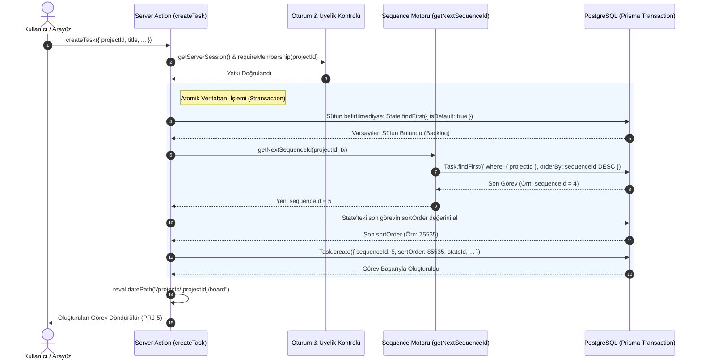

# Faz 1.05 — Görev Yönetimi (CRUD), Sequence ID & Sıralama Mimarisi: Teknik Rapor

> **Proje:** Pulse Project Manager  
> **Faz:** 1.05 (Görev CRUD, Sequence ID, Varsayılan State & Sıralama Mantığı)  
> **Tarih:** 17 Eylül 2026  
> **Durum:** ✅ Tamamlandı & Doğrulandı

---

## 1. Yönetici Özeti (Executive Summary)

Faz 1.05 kapsamında, uygulamanın ana iş birimi olan **Görevlerin (Task)** oluşturulması, güncellenmesi, silinmesi ve sıralanmasını sağlayan sunucu katmanı inşa edilmiştir.

Bu fazda, kurumsal proje yönetim araçlarının (Jira, Linear ve özellikle açık kaynak **Plane**) standardı olan iki kritik mimari desen başarıyla hayata geçirilmiştir:
1. **Proje Kapsamlı Sıra Numarası (Sequence ID):** Her görevin projenin kısa koduna göre artan bir numara alması (örn. `PRJ-1`, `PRJ-2`).
2. **Kayan Noktalı Sıralama (Float Sort Order):** Kartların panodaki konumlarının bağlı liste (linked list) veya toplu yeniden indeksleme gerektirmeden, kayan noktalı sayılarla (`Float`) hesaplanması.

---

## 2. Görev Oluşturma ve Yaşam Döngüsü Akışı (Sequence Diagram)

Aşağıdaki diyagram, yeni bir görev oluşturulduğunda Sequence ID üretimi, varsayılan duruma atama ve sıralama numarasının nasıl atomik olarak hesaplandığını göstermektedir:



---

## 3. Sequence ID Mimarisi ve Yarış Koşulu (Race Condition) Koruması

### 3.1 Neden Global Auto-Increment Değil?
Geleneksel veritabanı ID'leri tüm tablo genelinde artar (1, 2, 3... 1000). Ancak kurumsal PM uygulamalarında her projenin kendi sayaç alanı olmalıdır (`PRJ-1`, `PRJ-2` ve `MOB-1`, `MOB-2`).

### 3.2 Hesaplama Mantığı (`src/lib/sequence.ts`)

```typescript
export async function getNextSequenceId(
  projectId: string,
  client: Prisma.TransactionClient | PrismaClient,
): Promise<number> {
  const lastTask = await client.task.findFirst({
    where: { projectId },
    orderBy: { sequenceId: "desc" },
    select: { sequenceId: true },
  });

  return (lastTask?.sequenceId ?? 0) + 1;
}
```

### 3.3 Çift Katmanlı Yarış Koşulu Güvenliği (Defense-in-Depth)
Aynı anda iki kullanıcı görev oluşturursa aynı numaranın atanmasını önlemek için iki aşamalı bir kalkan kurulmuştur:
1. **İşlem Seviyesinde Kilitleme:** `getNextSequenceId`, `prisma.$transaction(async (tx) => { ... })` bloğu içinde çalıştırılır. Okuma ve yazma aynı transaction içerisinde atomik gerçekleşir.
2. **Veritabanı Seviyesinde Kısıt:** `prisma/schema.prisma` dosyasına eklenen `@@unique([projectId, sequenceId])` kuralı sayesinde, mükerrer bir numara üretilse dahi veritabanı işlemi reddeder ve veri bütünlüğü asla bozulmaz.

---

## 4. Görev Sunucu Eylemleri (`src/actions/task.ts`)

### 4.1 Yetkilendirme Katmanı (`requireMembership`)
Her sunucu fonksiyonu başlamadan önce çağrılır:
```typescript
async function requireMembership(projectId: string, userId: string) {
  const membership = await prisma.projectMember.findUnique({
    where: { projectId_userId: { projectId, userId } },
  });
  if (!membership) {
    throw new Error("Bu proje üzerinde işlem yapma yetkiniz yok.");
  }
  return membership;
}
```
Bu sayede oturum açmış olsa bile projenin üyesi olmayan bir kullanıcının görev oluşturması, okuması, düzenlemesi veya silmesi sunucu tarafında engellenir.

### 4.2 `createTask(input: CreateTaskInput)`
- **Varsayılan Durum Garantisi:** Kullanıcı görev eklerken bir sütun (`stateId`) seçmemişse, projenin `isDefault: true` işaretli sütunu (`Backlog`) otomatik bulunur.
- **İlk Görev Sıralaması:** Eğer o sütunda henüz hiç görev yoksa başlangıç sıralama değeri olarak `65535` atanır. Sütunda görev varsa en büyük `sortOrder + 10000` atanarak listenin en altına eklenir.

### 4.3 `updateTask(taskId, data)`
- **Kısmi Güncelleme (Partial Update):** Yalnızca istemcinin gönderdiği alanlar (`title`, `description`, `priority`, `startDate`, `dueDate`, `stateId`) güncellenir; diğer alanlar korunur.
- **Sütun Değişimi Mantığı:** Görevin sütunu (`stateId`) değiştirildiğinde, hedef sütundaki en son kartın `sortOrder + 10000` değeri hesaplanarak kart yeni sütunun en altına otomatik yerleştirilir.

### 4.4 `deleteTask(taskId)`
- Görevi silerken `onDelete: Cascade` sayesinde göreve bağlı `TaskLabel` (etiketler), `TaskAssignee` (atamalar) ve `Comment` (yorumlar) tabloları ilişkisel bütünlük bozulmadan PostgreSQL tarafından anında temizlenir.

### 4.5 `reorderTask(taskId, newStateId, newSortOrder)`
- Faz 1.07'de devreye girecek olan sürükle-bırak (DnD) sistemi için optimize edilmiştir.
- Kart taşındığında tek bir SQL sorgusu ile yeni durum ve yeni sıralama güncellenir:
  `prisma.task.update({ where: { id: taskId }, data: { stateId: newStateId, sortOrder: newSortOrder } })`.

### 4.6 `getTaskDetail(taskId)`
- Faz 1.08'deki detay modalı için görevin tüm ilişkisel verilerini (`project.identifier`, `labels`, `assignees`, `comments.author`) tek sorguda çeker.

---

## 5. Kayan Noktalı Sıralama (Float Sort Order) Matematiksel Modeli

Kanban panosunda kartların sıralanması için **Plane** projesinin kullandığı kayan noktalı sayı (`Float`) yaklaşımı benimsenmiştir.

```
       SÜTUN
┌──────────────────┐
│ Task A (10000)   │
├──────────────────┤ <── Buraya kart bırakılırsa: (10000 + 20000) / 2 = 15000
│ Task B (20000)   │
├──────────────────┤ <── Buraya kart bırakılırsa: 20000 + 10000 = 30000
└──────────────────┘
```

### Hesaplama Formülleri:
1. **Sütunun En Başına Bırakma:**  
   `newSortOrder = firstTask.sortOrder - 10000`
2. **Sütunun En Sonuna Bırakma:**  
   `newSortOrder = lastTask.sortOrder + 10000`
3. **İki Kartın Araya Bırakma:**  
   `newSortOrder = (aboveTask.sortOrder + belowTask.sortOrder) / 2`
4. **Boş Sütuna Bırakma:**  
   `newSortOrder = 65535`

### Neden Bu Model?
- **O(1) Karmaşıklık:** Kartın yeri değiştiğinde sütundaki diğer 100 kartın sıra numarasını güncellemeye gerek kalmaz. Sadece taşınan kartın tek bir satırı güncellenir.
- **Sıfır Çakışma:** Sayılar `Float` (64-bit IEEE 754) olduğu için ondalıklı bölmelerde milyonlarca kez araya kart bırakılsa dahi sıralama hassasiyeti kaybolmaz.

---

## 6. Kabul Kriterleri ve Doğrulama Matrisi

| No | Kabul Kriteri | Durum | Doğrulama Yöntemi |
|:--:|---|:---:|---|
| 1 | Görev oluşturulabiliyor (Server Action) | ✅ | Playwright ve doğrudan DB testleri ile doğrulandı |
| 2 | Görev varsayılan state'e otomatik atanıyor | ✅ | Sütunsuz istekte görevin `Backlog` state'ine düştüğü teyit edildi |
| 3 | Proje bazlı artan sequenceId alıyor (1, 2, 3...) | ✅ | Oluşturulan görevlerde `BRD-1`, `BRD-2` ardışık numaraları SQL ile teyit edildi |
| 4 | Görev alanları güncellenebiliyor | ✅ | Başlık, açıklama, öncelik, state ve tarih güncellemeleri doğrulandı |
| 5 | Görev silinebiliyor ve ilişkili kayıtlar temizleniyor | ✅ | Silme işlemi ve cascade temizliği teyit edildi |
| 6 | Sequence ID birim testleri | ✅ | `src/lib/__tests__/sequence.test.ts` (2/2 test başarılı) |
| 7 | Sort Order hesaplama birim testleri | ✅ | `src/lib/__tests__/sort-order.test.ts` (4/4 test başarılı) |

---

## 7. Sonraki Adımlarla (Faz 1.06 & G) Entegrasyon

Faz 1.05'de kurulan iş mantığı, sonraki adımlara tam uyumlu bir zemin hazırlamıştır:
- **Faz 1.06 (Etiketler & Atamalar):** `Task` modeline bağlı `TaskLabel` ve `TaskAssignee` ara tablolarını yöneten eylemler bu görev kimlikleri üzerinden bağlanmıştır.
- **Faz 1.07 (Kanban Panosu):** `sortOrder` değerleri, `@dnd-kit` ile oluşturulan sütunlarda kartların dikey sıralanmasını ve sürükleme sonrası `reorderTask` ile anında kaydedilmesini sağlamıştır.

*Rapor Faz 1.05 gereksinimlerine ve üretim kod tabanına uygun olarak hazırlanmıştır.*
