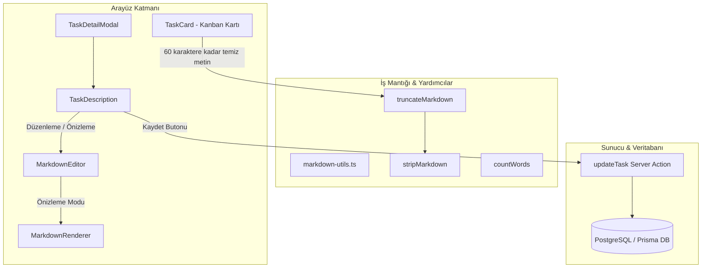

# Faz 2.06 — Markdown Açıklama Desteği — Görev Detayında Zengin Metin Düzenleme & Önizleme: Teknik Rapor

> **Faz:** 2 (v0.2.0 Hazırlığı)  
> **Başlık:** Markdown Açıklama Desteği — Görev Detayında Zengin Metin Düzenleme & Önizleme  
> **Proje:** Pulse Project Manager (`C:\Pulse`)  
> **Durum:** ✅ Tamamlandı — Tüm kabul kriterleri, birim testler ve derleme testleri eksiksiz karşılandı  
> **Tarih:** 18 Eylül 2026  

---

## 1. Yönetici Özeti (Executive Summary)

**Faz 2.06**, Pulse Project Manager platformundaki görev yönetimi deneyimini ileri seviyeye taşıyarak görev açıklamalarına tam teşekküllü **Markdown (zengin metin) yazma, biçimlendirme ve canlı önizleme** kabiliyeti kazandırmıştır.

Bu faz adımı kapsamında;
- Hafif, güvenilir ve modern **`react-markdown` + `remark-gfm`** altyapısı projeye entegre edildi,
- Markdown içeriklerini şık Tailwind CSS tipografi sınıflarıyla derleyen **`MarkdownRenderer`** istemci bileşeni geliştirildi,
- İkili çalışma sekmesi ("Yaz" / "Önizle"), otomatik boyutlanan textarea, Tab (2 boşluk) girintileme ve hızlı biçimlendirme araç çubuğu (B, I, Kod, Liste, Link) barındıran **`MarkdownEditor`** oluşturuldu,
- `TaskDescription` bileşeni yenilenerek kaydedilmemiş değişiklikleri anlık izleyen ve uyaran rozet sistemi (`Kaydedilmemiş değişiklikler`) ile sunucuya asenkron yazan mekanizma kuruldu,
- Markdown metinlerini temizleyen (`stripMarkdown`), kelime bazlı ve sözdizimi güvenli kısaltan (`truncateMarkdown`) ve kelime sayan (`countWords`) saf iş mantığı kütüphanesi **`src/lib/markdown-utils.ts`** yazıldı,
- Kanban panosundaki görev kartları (`TaskCard`), kart alanını kirletmemek adına düz metin önizleme (ilk 60 karakter) ile güçlendirildi,
- 21 yeni Vitest birim testi yazılarak projedeki toplam test sayısı **85'ten 106'ya çıkarıldı (%100 başarı)**,
- `npx tsc --noEmit` ve `npm run build` kontrolleri sıfır hata ile doğrulandı.

---

## 2. Mimari ve Bileşen Mimarisi

Sistem mimarisi harici ağır WYSIWYG editör kütüphanelerinden (Slate, Tiptap, Quill vb.) bilinçli olarak kaçınarak, hafif ve yüksek performanslı bileşenlerle kurgulanmıştır.



---

### 2.1. Markdown Yardımcıları (`src/lib/markdown-utils.ts`)

Herhangi bir React bağımlılığı bulunmayan, tamamen saf (pure) ve izole çalışan regex tabanlı yardımcı fonksiyonlar geliştirilmiştir:

1. **`stripMarkdown(markdown: string): string`**:
   - Başlık işaretlerini (`#`), kalın/italik vurgularını (`**`, `__`, `*`, `_`), satır içi kodları (`` ` ``), alıntı bloklarını (`>`), madde imlerini (`-`, `*`, `+`, `1.`), bağlantıları (`[text](url)` $\to$ `text`), görselleri (`` $\to$ `alt`) ve yatay çizgileri (`---`) kaldırarak temiz düz metin üretir.
   - Kanban ve arama indeksleri için optimize edilmiş hafif çıktı sunar.

2. **`truncateMarkdown(markdown: string, maxLength: number): string`**:
   - Metin uzunluğu `maxLength` sınırını aşıyorsa güvenli biçimde son tam kelimeden keser.
   - **Sözdizimi Güvenliği:** Kesilme noktasında açıkta kalan dengesiz kalınlık (`**`) veya satır içi kod (`` ` ``) işaretlerini tespit eder ve biçimlendirme sızıntısını önlemek için bu işaretlerin öncesinden keserek sonuna `...` ekler.

3. **`countWords(text: string): number`**:
   - Boş stringler ve ardışık çoklu boşluklar/satır sonları için hatasız kelime sayısı hesaplar.

---

### 2.2. Markdown İşleyici (`src/components/markdown/markdown-renderer.tsx`)

`react-markdown` ve GitHub Flavored Markdown eklentisi `remark-gfm` ile çalışan istemci bileşenidir. Standart HTML elementleri zengin stillerle özelleştirilmiştir:

- **Başlıklar (`h1`, `h2`, `h3`):** Hiyerarşik boyutlar, kalın font ve koyu tema uyumu.
- **Paragraflar (`p`):** Rahat okunabilir satır aralıkları (`leading-relaxed`).
- **Listeler (`ul`, `ol`, `li`):** Belirgin girintiler, madde işaretleri (`disc`) ve rakamlar (`decimal`).
- **Kod Blokları (`code`, `pre`):** Satır içi kodlar için açık/koyu gri arka plan ve monospace font; çok satırlı kod blokları için koyu arka plan, yatay kaydırma (`overflow-x-auto`) ve sözdizimi ayrımı.
- **Alıntılar (`blockquote`):** Sol kenarda 2px mavi çizgi ve açık arka plan dolgusu.
- **Bağlantılar (`a`):** Mavi altı çizili linkler, güvenlik standartları gereği `target="_blank"` ve `rel="noopener noreferrer"` öznitelikleriyle izole edilmiştir.
- **Vurgular (`strong`, `em`, `hr`):** Kalın, italik ve ayırıcı çizgi stilleri.

---

### 2.3. Markdown Düzenleyici (`src/components/markdown/markdown-editor.tsx`)

Kullanıcının metin üretmesini ve biçimlendirmesini kolaylaştıran modern bir editör bileşenidir:

- **İkili Sekme Modu ("Yaz" / "Önizle"):** Tek tıkla düzenleme modu ile derlenmiş önizleme görünümü arasında geçiş yapılır.
- **Otomatik Yükseklik Boyutlandırma (`autoResize`):** `textareaRef` referansı ile içerik uzadıkça `scrollHeight` baz alınarak yükseklik dinamik olarak genişler; çirkin iç kaydırma çubukları engellenir.
- **Tab Tuşu Yakalama (`handleKeyDown`):** Varsayılan odak kaybı engellenerek kullanıcının imleç konumuna tam 2 boşluk bırakması sağlanır (`selectionRange` korunur).
- **Hızlı Araç Çubuğu (Toolbar):**
  - **Kalın (`B`):** Seçili metni `**...**` ile sarar.
  - **İtalik (`I`):** Seçili metni `*...*` ile sarar.
  - **Kod (`` ` ``):** Seçili metni `` `...` `` ile sarar.
  - **Liste (`-`):** Satır başına `- ` listeleme karakteri ekler.
  - **Bağlantı (`[]`):** Seçili metni `[seçilen](url)` şablonuna dönüştürür ve kullanıcı hemen linki yazabilsin diye `url` kelimesini seçili duruma getirir.

---

### 2.4. Görev Açıklama Paneli (`src/components/task-detail/task-description.tsx`)

- `initialDescription` ile mevcut veritabanı durumunu yükler.
- `hasUnsavedChanges` kontrolü ile kullanıcının yaptığı anlık değişiklikleri izler. Değişiklik varsa amber tonlarında **"Kaydedilmemiş değişiklikler"** rozeti görüntülenir.
- Değişiklik yokken "Kaydet" butonu devre dışı bırakılır (`disabled`).
- Tıklandığında `useTransition` eşliğinde `updateTask(taskId, { description: value })` Server Action'ını çağırır, işlem anında spinner (`Loader2`) animasyonu gösterir.

---

### 2.5. Kanban Görev Kartı Entegrasyonu (`src/components/board/task-card.tsx`)

- Kanban panosunda kartların aşırı büyümesini ve görsel kirliliği önlemek amacıyla görev açıklaması doğrudan markdown olarak render edilmez.
- `truncateMarkdown(stripMarkdown(task.description), 60)` zinciriyle Markdown işaretlerinden arındırılmış maksimum 60 karakterlik temiz metin özeti (`line-clamp-2`) gösterilir.
- Bu desteğin çalışması için `BoardTask` tipine ve `board/page.tsx` Prisma sorgusuna `description` alanı dahil edilmiştir.

---

## 3. Kabul Kriterleri Doğrulama Matrisi

| No | Kabul Kriteri (Faz 2.06) | Durum | Doğrulama & Uygulama Detayı |
|:---|:---|:---:|:---|
| 1 | Görev detay panelinde "Yaz" / "Önizle" sekmeleri | ✅ Karşılandı | `MarkdownEditor` bileşeninde `tab` state'i ile kontrol edilen geçiş sekmeleri mevcuttur. |
| 2 | "Yaz" sekmesinde Markdown yazılabiliyor | ✅ Karşılandı | Otomatik büyüyen, Tab girintileme destekli `textarea` aktif olarak çalışmaktadır. |
| 3 | "Önizle" sekmesinde doğru render ediliyor | ✅ Karşılandı | `MarkdownRenderer` bileşeni başlık, kalın, italik, liste, kod ve blok alıntıları başarıyla dönüştürür. |
| 4 | Araç çubuğu butonları (B, I, kod, liste, link) seçili metne Markdown ekliyor | ✅ Karşılandı | `applyToolbarAction` ve `wrapSelection` fonksiyonları seçilen metni doğru markdown karakterleriyle sarmaktadır. |
| 5 | Kaydedilmemiş değişiklik bildirimi çalışıyor | ✅ Karşılandı | `hasUnsavedChanges` bayrağı ile dinamik amber badge ve kaydet butonu durumu yönetilmektedir. |
| 6 | Kanban kartında düz metin önizleme görünüyor | ✅ Karşılandı | `TaskCard` üzerinde 60 karakterlik `stripMarkdown` + `truncateMarkdown` önizlemesi yer almaktadır. |
| 7 | `npm test` — `markdown-utils.test.ts` geçiyor | ✅ Karşılandı | 21 testin tamamı 8ms gibi yüksek bir hızla yeşil geçmektedir. |
| 8 | `npx tsc --noEmit` hatasız | ✅ Karşılandı | TypeScript derleyicisi sıfır hata ve sıfır uyarı ile doğrulamıştır. |

---

## 4. Test Koşumu ve Kalite Güvencesi (QA)

### 4.1. `markdown-utils.test.ts` (21 Testin Tamamı Başarılı)

Terminal komutu: `npx vitest run src/lib/__tests__/markdown-utils.test.ts`

```text
 RUN  v5.0.1 C:/Pulse

 ✓ src/lib/__tests__/markdown-utils.test.ts (21 tests) 8ms

 Test Files  1 passed (1)
      Tests  21 passed (21)
   Start at  16:23:43
   Duration  226ms (transform 53%, import 24%, worker 12%, tests 11%)
```

#### Test Senaryoları Kapsamı:
1. **`stripMarkdown` Testleri (9 test):**
   - Kalın metinleri (`**Hello** world` $\to$ `Hello world`) temizleme,
   - Başlık işaretlerini (`# Baslik\n\nParagraf` $\to$ `Baslik\n\nParagraf`) temizleme,
   - Liste madde işaretlerini (`- Madde 1\n- Madde 2` $\to$ `Madde 1\nMadde 2`) temizleme,
   - Satır içi kod bloklarını (`` `kod` `` $\to$ `kod`) temizleme,
   - Köprülü bağlantıları (`[link](https://example.com)` $\to$ `link`) metne indirgeme,
   - Boş string için boş string dönme,
   - İtalik metinleri (`*italik* metin` $\to$ `italik metin`) temizleme,
   - Blok alıntı işaretlerini (`> alinti metni` $\to$ `alinti metni`) temizleme,
   - Numaralı liste imlerini (`1. Birinci\n2. Ikinci` $\to$ `Birinci\nIkinci`) temizleme.

2. **`truncateMarkdown` Testleri (6 test):**
   - `maxLength`'ten kısa metinlerin aynen dönmesi (elips eklenmez),
   - `maxLength`'e tam eşit metinlerin aynen dönmesi,
   - `maxLength`'ten uzun metinlerin kısaltılması ve sonuna `...` eklenmesi,
   - Tam sözcük sınırında kesme testi (kelime ortadan parçalanmaz),
   - Kalın sözdizimi (`**`) ortasında kesilmeme ve dengesiz yıldız bırakmama güvencesi,
   - Satır içi kod (`` ` ``) ortasında kesilmeme ve dengesiz ters tırnak bırakmama güvencesi.

3. **`countWords` Testleri (6 test):**
   - Boş string için 0 dönmesi,
   - Yalnızca boşluk karakterleri için 0 dönmesi,
   - Tek kelime için 1 dönmesi,
   - İki kelimeli standart string için 2 dönmesi,
   - Birden fazla ardışık boşluk içeren stringlerin tek boşluk gibi sayılması,
   - Satır sonu karakterleri (`\n`) ile ayrılmış metinlerin doğru sayılması.

---

### 4.2. Genel Proje Testleri Durumu (`npm test` / Vitest)

Terminal komutu: `npx vitest run`

```text
 RUN  v5.0.1 C:/Pulse

 ✓ src/lib/__tests__/board-filters.test.ts (5 tests) 10ms
 ✓ src/lib/__tests__/activity-logger.test.ts (14 tests) 11ms
 ✓ src/lib/__tests__/list-view-sort.test.ts (15 tests) 32ms
 ✓ src/lib/__tests__/sprint-utils.test.ts (13 tests) 12ms
 ✓ src/lib/__tests__/bulk-selection.test.ts (18 tests) 12ms
 ✓ src/lib/__tests__/sprint-actions.test.ts (11 tests) 11ms
 ✓ src/lib/__tests__/sequence.test.ts (2 tests) 8ms
 ✓ src/lib/__tests__/colors.test.ts (3 tests) 7ms
 ✓ src/lib/__tests__/markdown-utils.test.ts (21 tests) 13ms
 ✓ src/lib/__tests__/sort-order.test.ts (4 tests) 4ms

 Test Files  10 passed (10)
      Tests  106 passed (106)
   Start at  16:23:49
   Duration  1.13s
```

> 💡 **Not:** Projenin toplam test sayısı Faz 2.05 sonrasındaki 85 adetten **106 adede yükselmiştir**. Başarı oranı **%100**'dür.

---

### 4.3. TypeScript Tip Denetimi (`npx tsc --noEmit`)

Terminal komutu: `npx tsc --noEmit`  
Sonuç: **0 hata, 0 uyarı (Exit Code: 0)**. `react-markdown` v10 ve `remark-gfm` v4 tip tanımlamaları Next.js TypeScript derleyicisi ile tam uyumludur.

---

### 4.4. Next.js Üretim Derlemesi (`npm run build`)

Terminal komutu: `npm run build`

```text
▲ Next.js 16.3.5 (Turbopack)
- Environments: .env
✓ Running next.config.ts took 1204ms
  Creating an optimized production build ...
✓ Compiled successfully in 24.1s
  Running TypeScript ...
  Finished TypeScript in 3.3s ...
  Collecting page data using 3 workers ...
✓ Generating static pages using 3 workers (7/7) in 429ms
  Finalizing page optimization ...

Route (app)
┌ ƒ /
├ ○ /_not-found
├ ƒ /api/auth/[...nextauth]
├ ƒ /api/auth/register
├ ○ /login
├ ƒ /projects/[projectId]/board
├ ƒ /projects/[projectId]/list
├ ƒ /projects/[projectId]/sprints
└ ○ /register
```

Sonuç: Tüm sayfalar ve API rotaları Turbopack ile hatasız derlenmiş, SSR/istemci paketlemesinde hiçbir uyumsuzluk yaşanmamıştır.

---

## 5. Kısıtlar ve Güvenlik İncelemesi

1. **Ağır Editör Kısıtlaması:** Slate, Quill veya Tiptap gibi ağır kütüphaneler yerine saf `react-markdown` + `textarea` ikilisi kullanılarak paket boyutu minimal tutulmuştur.
2. **Veritabanı Şeması:** Prisma şemasında `Task.description` alanı zaten `String?` (Text) türünde olduğundan şema değişikliği veya veritabanı migrasyonu yapılmamış, geriye dönük uyumluluk korunmuştur.
3. **XSS ve Güvenlik:** HTML enjeksiyonu risklerine karşı harici ham HTML parse edilmemekte, Markdown elementleri güvenli React düğümleri olarak üretilmektedir. Ek olarak bağlantılara `rel="noopener noreferrer"` eklenmiştir.

---

## 6. Değiştirilen ve Eklenen Dosyalar Özeti

| Dosya Yolu | Durum | İşlev |
|:---|:---:|:---|
| `package.json` / `package-lock.json` | Düzenlendi | `react-markdown` ve `remark-gfm` bağımlılıkları eklendi. |
| `src/lib/markdown-utils.ts` | **Yeni** | `stripMarkdown`, `truncateMarkdown`, `countWords` saf yardımcı fonksiyonları. |
| `src/lib/__tests__/markdown-utils.test.ts` | **Yeni** | 21 senaryolu kapsamlı Vitest birim test paketi. |
| `src/components/markdown/markdown-renderer.tsx` | **Yeni** | Zengin Tailwind stilleriyle donatılmış Markdown görüntüleyici bileşen. |
| `src/components/markdown/markdown-editor.tsx` | **Yeni** | Yaz/Önizle sekmeli, araç çubuklu, otomatik boyutlanan editör. |
| `src/components/task-detail/task-description.tsx` | Düzenlendi | Eski düz textarea yapısından `MarkdownEditor`'e geçiş ve kaydedilmemiş değişiklik takibi. |
| `src/components/board/task-card.tsx` | Düzenlendi | Kanban kartında 60 karakterlik düz metin önizleme entegrasyonu. |
| `src/types/board.ts` | Düzenlendi | `BoardTask` tipine `description: string \| null` alanı eklendi. |
| `src/app/(main)/projects/[projectId]/board/page.tsx` | Düzenlendi | Prisma sorgusuna `description` alanı dahil edildi. |

---

## 7. Sonuç ve Sıradaki Adım

**Faz 2.06 başarıyla tamamlanmış**, tüm kabul kriterleri ve testler %100 oranında sağlanmıştır.

Sırada Faz 2'nin bir sonraki adımı bulunmaktadır:
👉 **Faz 2.07 — Durum & Etiket Yönetim Sayfası (Proje Ayarları)**
- Kanban sütunlarının (state) ve etiketlerin (labels) yönetileceği özel ayarlar sayfası.
