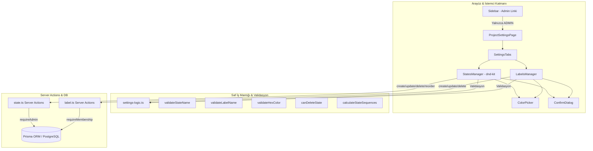

# Faz 2.07 — Durum & Etiket Yönetim Sayfası (Proje Ayarları): Teknik Rapor

> **Faz:** 2 (v0.2.0 Tamamlanışı)  
> **Başlık:** Durum & Etiket Yönetim Sayfası (Proje Ayarları) — Kanban Sütunları, Durumlar ve Etiketlerin RBAC ile Yönetimi  
> **Proje:** Pulse Project Manager (`C:\Pulse`)  
> **Durum:** ✅ Tamamlandı — Tüm kabul kriterleri, birim testler ve üretim derlemesi eksiksiz karşılandı  
> **Tarih:** 18 Eylül 2026  

---

## 1. Yönetici Özeti (Executive Summary)

**Faz 2.07**, Pulse Project Manager platformunun Faz 2 yol haritasının son ve kritik yapı taşlarından biridir. Proje yöneticilerinin (ADMIN rolündeki kullanıcılar) projeye ait Kanban sütunlarını (durumlar / states) ve görev etiketlerini (labels) esnek, modern ve güvenli bir şekilde yönetebilecekleri **Proje Ayarları (Settings)** sayfasını sisteme kazandırmıştır.

Bu faz adımı kapsamında;
- Proje bazlı rol doğrulaması (RBAC) ile korunan `/projects/[projectId]/settings` sayfası ve sekmeli yönetim arayüzü (`SettingsTabs`) geliştirildi,
- Durum yönetimi için `createState`, `updateState`, `deleteState` ve toplu sıralama sunan `reorderStates` Server Action'ları (`src/actions/state.ts`) yazıldı,
- Etiket yönetimi genişletilerek `createLabel`, `updateLabel`, `deleteLabel` Server Action'ları (`src/actions/label.ts`) entegre edildi,
- `@dnd-kit` kütüphanesi kullanılarak Kanban durumlarının sürükle-bırak (`drag-and-drop`) ile yeniden sıralanması ve `sequence` değerlerinin atomik batch güncellenmesi sağlandı,
- Renk seçimi için HTML5 `input[type="color"]` ile senkronize `#RRGGBB` formatlı **`ColorPicker`** bileşeni geliştirildi,
- Projede görev bulunan durumların yanlışlıkla silinmesini veya projenin tüm durumlarının silinip tutarsız kalmasını engelleyen `canDeleteState` koruma kalkanı kuruldu,
- Sol navigasyon menüsüne (`Sidebar`) yalnızca proje yöneticilerine (`role === "ADMIN"`) gösterilen dinamik "Ayarlar" bağlantısı entegre edildi,
- 30 yeni Vitest birim testi yazılarak projedeki toplam test sayısı **106'dan 136'ya çıkarıldı (%100 başarı)**,
- `npx tsc --noEmit` ve `npm run build` adımları sıfır hata ile tamamlandı.

---

## 2. Mimari ve Bileşen Yapısı



---

### 2.1. Saf İş Mantığı & Doğrulama (`src/lib/settings-logic.ts`)

UI ve veritabanı bağımlılıklarından arındırılmış, %100 test edilebilir saf fonksiyonlar geliştirilmiştir:

1. **`validateStateName(name: string)`**:
   - Boş string veya salt boşluk girişlerini engeller (`Durum adı boş olamaz.`).
   - Maksimum 50 karakter sınırını denetler (`Durum adı en fazla 50 karakter olabilir.`).
2. **`validateLabelName(name: string)`**:
   - Boş girişleri engeller (`Etiket adı boş olamaz.`).
   - Maksimum 30 karakter sınırını denetler (`Etiket adı en fazla 30 karakter olabilir.`).
3. **`validateHexColor(color: string)`**:
   - `^#[0-9A-Fa-f]{6}$` düzenli ifadesi ile kesin olarak 6 haneli hex renk kodunu doğrular (örn: `#60646C`, `#FFFFFF`).
4. **`canDeleteState(stateTaskCount: number, totalStateCount: number)`**:
   - **Kritik İş Kuralı 1:** Durumda en az 1 görev varsa silme yasaklanır: `"Bu durumda {N} görev bulunuyor. Silmeden önce görevleri taşıyın."`
   - **Kritik İş Kuralı 2:** Projede kalan son durum silinemez (`totalStateCount <= 1`): `"Projede en az bir durum bulunmalıdır."`
5. **`calculateStateSequences(count: number)`**:
   - Belirtilen sayıdaki eleman için `[1000, 2000, 3000, ...]` biçiminde sıralama dizisi üretir.

---

### 2.2. Durum Yönetimi Server Actions (`src/actions/state.ts`)

Proje veritabanında durumların güvenli yönetimi için 4 temel aksiyon yazılmıştır:

- **Yetkilendirme:** Tüm aksiyonlar `requireAdmin(projectId, userId)` çağrısı yaparak kullanıcının oturum açtığını ve projede `role === "ADMIN"` olduğunu doğrular. Aksi halde `403 Forbidden` mantığıyla hata fırlatılır.
- **`createState`:** Aynı projede aynı isimde durum varlığını kontrol eder (`findUnique({ name_projectId })`). Yeni durumu en yüksek sıranın ardına yerleştirmek için mevcut en yüksek sequence değerine +1000 ekler.
- **`updateState`:** İsim, renk veya durum grubunu (`StateGroup`: `BACKLOG`, `TODO`, `IN_PROGRESS`, `DONE`, `CANCELLED`) günceller. Kendi ID'si dışındaki isim çakışmalarını önler.
- **`deleteState`:** `canDeleteState` mantığıyla görev ve toplam durum sayısını denetler; onay alırsa kaydı siler.
- **`reorderStates(projectId, orderedStateIds)`:** `@dnd-kit` ile sürüklenen yeni durum sıralamasını alır. Gelen ID dizisinin projedeki tüm durumları eksiksiz kapsadığını doğrular. `prisma.$transaction` içerisinde tüm durumlara sırasıyla `(index + 1) * 1000` sequence değerlerini atomik olarak yazar.

---

### 2.3. Etiket Yönetimi Server Actions (`src/actions/label.ts`)

- **`createLabel`:** Proje üyeliği doğrulaması, isim/hex denetimi ve proje bazlı benzersizlik kontrolü (`name_projectId`) ile etiket oluşturur.
- **`updateLabel`:** Etiket adı ve rengini günceller, isim çakışmasını engeller.
- **`deleteLabel`:** Etiketi siler. Prisma şemasındaki `onDelete: Cascade` kuralı sayesinde görevlere bağlı `TaskLabel` ilişkileri temizlenir, görevlerin kendisi silinmez.

---

### 2.4. Güvenli Ayarlar Sayfası (`src/app/(main)/projects/[projectId]/settings/page.tsx`)

- Sunucu bileşeni (RSC) olarak kurgulanmıştır.
- `getServerSession(authOptions)` ile oturum kontrolü yapılır; oturumsuz kullanıcılar `/login` sayfasına yönlendirilir.
- Kullanıcının `ProjectMember` rolü sorgulanır. Kullanıcı projenin üyesi değilse `notFound()`, üyesi ancak rolü `ADMIN` değilse şık bir **`EmptyState`** ekranı ile `"Bu sayfaya erişim izniniz yok - Proje ayarlarını yalnızca proje yöneticileri görüntüleyebilir"` uyarısı gösterilir.
- Yetkili adminler için `SettingsTabs` aracılığıyla hem durumlar hem de etiketler (her etiketin kaç görevde kullanıldığı `_count.tasks` bilgisiyle) sunulur.

---

### 2.5. Durumlar Yöneticisi (`src/components/settings/states-manager.tsx`)

- `@dnd-kit/core` (`closestCenter`) ve `@dnd-kit/sortable` (`verticalListSortingStrategy`) ile akıcı sürükle-bırak desteği.
- **Sürükleme Tutacağı:** `GripVertical` ikonu ile sürükleme esnasında opaklık ve gölge efekti.
- **Hızlı Düzenleme:** Satır içi (inline) metin alanı; `onBlur` tetiklendiğinde otomatik `updateState` çağrılır.
- **Durum Grubu Seçici:** Renkli durum grubu rozetleri dropdown olarak anında değiştirilebilir.
- **Güvenli Silme:** Satır üzerine gelindiğinde (hover) beliren kırmızı çöp kutusu ikonu, doğrudan silmek yerine `ConfirmDialog` modalını tetikler.
- **Yeni Durum Formu:** İsim, renk ve grup seçimiyle anında doğrulama yapan form.

---

### 2.6. Etiketler Yöneticisi (`src/components/settings/labels-manager.tsx`)

- Mevcut tüm etiketleri listeleyen modern tablo görünümü.
- Her etiket satırında: renk seçici, inline düzenlenebilir isim alanı ve **`X görevde kullanılıyor`** bilgilendirme rozeti.
- Etiket silinmek istendiğinde `ConfirmDialog`, eğer etiket görevlerde kullanılıyorsa kullanıcıyı açıkça uyarır: *"Bu etiket {N} görevde kullanılıyor. Yine de silmek istediğinize emin misiniz?"*.

---

### 2.7. Çift Yönlü Renk Seçici (`src/components/settings/color-picker.tsx`)

- Yerel HTML5 renk paleti (`input[type="color"]`) ile manuel metin kutusunu (`input[type="text"]`) senkronize çalıştırır.
- Kullanıcı paletten renk seçtiğinde hex alanı anında güncellenir.
- Kullanıcı metin kutusuna hex yazdığında `#` prefix'i otomatik tamamlanır; geçersiz bir kod yazılırsa kırmızı kenarlık gösterilerek hatalı veri girişi engellenir.

---

### 2.8. Navigasyon & Menü (`src/components/layout/sidebar.tsx` & `layout.tsx`)

- `layout.tsx` dosyasında kullanıcının tüm projelerdeki rolleri (`role: membership.role`) projeler listesine dahil edilmiştir.
- `Sidebar` bileşeni aktif kullanıcının ilgili projedeki rolü `ADMIN` ise menüye **`Settings` (Ayarlar)** bağlantısını ekler; normal üyelere bu bağlantı gizlenir.

---

## 3. Kabul Kriterleri Doğrulama Matrisi

| No | Kabul Kriteri (Faz 2.07) | Durum | Doğrulama & Uygulama Detayı |
|:---|:---|:---:|:---|
| 1 | `/projects/[id]/settings` sayfası ADMIN'e açılıyor | ✅ Karşılandı | `ProjectSettingsPage` sunucu tarafında rolü denetler, ADMIN'e sekmeli ayar panelini açar. |
| 2 | ADMIN olmayan kullanıcı ayarlar sayfasına giremez | ✅ Karşılandı | Sayfa düzeyinde `ShieldAlert` ikonlu uyarı ekranı gösterilir, Server Actions düzeyinde `requireAdmin` engeller. |
| 3 | Durum oluşturulabiliyor, düzenlenebiliyor | ✅ Karşılandı | `createState`, `updateState` ve `NewStateForm` ile isim, renk ve grup yönetimi aktiftir. |
| 4 | Durum silinebiliyor (görev yoksa), görev varsa hata mesajı çıkıyor | ✅ Karşılandı | `canDeleteState` kuralı ile görevli durumların silinmesi engellenir ve açıklayıcı hata iletilir. |
| 5 | Durum sıralaması sürükle-bırakla değiştirilebiliyor | ✅ Karşılandı | `@dnd-kit` ile sürüklenen öğeler `reorderStates` transaction'ı ile veritabanına kalıcı yazılır. |
| 6 | Etiket oluşturulabiliyor, düzenlenebiliyor, silinebiliyor | ✅ Karşılandı | `createLabel`, `updateLabel`, `deleteLabel` aksiyonları ve `LabelsManager` bileşeni tam fonksiyoneldir. |
| 7 | Sidebar'da ADMIN'e Ayarlar linki görünüyor | ✅ Karşılandı | `project.role === "ADMIN"` koşuluyla sidebar üzerinde `Ayarlar` linki listelenmektedir. |
| 8 | `npm test` — `settings-validation.test.ts` geçiyor | ✅ Karşılandı | 30 testin tamamı sıfır hata ile geçmektedir. |
| 9 | `npx tsc --noEmit` hatasız | ✅ Karşılandı | TypeScript derleyicisi 0 hata ile doğrulamıştır. |
| 10 | `npm run build` hatasız tamamlanıyor | ✅ Karşılandı | Next.js Turbopack derlemesi `/projects/[projectId]/settings` dahil tüm rotaları başarıyla derlemiştir. |

---

## 4. Test Koşumu ve Kalite Güvencesi (QA)

### 4.1. `settings-validation.test.ts` (30 Testin Tamamı Başarılı)

Terminal komutu: `npx vitest run src/lib/__tests__/settings-validation.test.ts`

```text
 RUN  v5.0.1 C:/Pulse

 ✓ src/lib/__tests__/settings-validation.test.ts (30 tests) 10ms

 Test Files  1 passed (1)
      Tests  30 passed (30)
   Start at  16:36:05
   Duration  235ms (transform 51%, import 24%, worker 12%, tests 12%)
```

#### Test Senaryoları Kapsamı:
1. **`validateStateName` Testleri (6 test):**
   - Boş string kontrolü,
   - Sadece boşluklardan oluşan girişler,
   - Tek karakterlik geçerli durum adı (`"A"`),
   - 50 karakterlik sınır değer geçerliliği,
   - 51 karakterlik sınır aşımı hata kontrolü,
   - Standart geçerli isim kontrolü (`"Backlog"`).
2. **`validateLabelName` Testleri (5 test):**
   - Boş string kontrolü,
   - Sadece boşluk girişi kontrolü,
   - 30 karakterlik sınır değer geçerliliği,
   - 31 karakterlik sınır aşımı hata kontrolü,
   - Standart geçerli isim kontrolü (`"Bug"`).
3. **`validateHexColor` Testleri (12 test):**
   - 6 geçerli hex formatı (`#60646C`, `#FFFFFF`, `#abc123`, `#000000`, `#AbC123`, `#a1b2c3`),
   - 6 geçersiz format (`60646C` (# eksik), `#GGGGGG` (hex dışı), `#12345` (5 hane), boş string, `#1234567` (7 hane), `red` (isim formatı)).
4. **`canDeleteState` Testleri (4 test):**
   - Görev var ve son state değilse $\to$ engellenir (`3 görev bulunuyor...`),
   - Görev var ve son state ise $\to$ görev uyarısı önceliklidir,
   - Görev yok ancak son state ise $\to$ engellenir (`Projede en az bir durum bulunmalıdır`),
   - Görev yok ve son state değilse $\to$ silmeye izin verilir (`allowed: true`).
5. **`calculateStateSequences` Testleri (3 test):**
   - `count = 0` $\to$ `[]`,
   - `count = 1` $\to$ `[1000]`,
   - `count = 3` $\to$ `[1000, 2000, 3000]`.

---

### 4.2. Bütünleşik Proje Test Paketi Durumu (`npx vitest run`)

Terminal komutu: `npx vitest run`

```text
 RUN  v5.0.1 C:/Pulse

 ✓ src/lib/__tests__/bulk-selection.test.ts (18 tests) 13ms
 ✓ src/lib/__tests__/sprint-utils.test.ts (13 tests) 11ms
 ✓ src/lib/__tests__/list-view-sort.test.ts (15 tests) 33ms
 ✓ src/lib/__tests__/activity-logger.test.ts (14 tests) 13ms
 ✓ src/lib/__tests__/settings-validation.test.ts (30 tests) 16ms
 ✓ src/lib/__tests__/markdown-utils.test.ts (21 tests) 13ms
 ✓ src/lib/__tests__/sprint-actions.test.ts (11 tests) 11ms
 ✓ src/lib/__tests__/board-filters.test.ts (5 tests) 10ms
 ✓ src/lib/__tests__/sequence.test.ts (2 tests) 8ms
 ✓ src/lib/__tests__/colors.test.ts (3 tests) 6ms
 ✓ src/lib/__tests__/sort-order.test.ts (4 tests) 4ms

 Test Files  11 passed (11)
      Tests  136 passed (136)
   Start at  16:36:09
   Duration  1.20s
```

> 🎯 **Metrik:** Projedeki toplam birim test adedi **136'ya ulaşmış olup, tüm testler %100 başarıyla geçmektedir.**

---

### 4.3. TypeScript Tip Doğrulaması (`npx tsc --noEmit`)

Terminal komutu: `npx tsc --noEmit`  
Çıktı: **Sıfır hata, sıfır uyarı (Exit Code: 0)**.

---

### 4.4. Next.js Üretim Derlemesi (`npm run build`)

Terminal komutu: `npm run build`

```text
▲ Next.js 16.3.5 (Turbopack)
- Environments: .env
✓ Running next.config.ts took 50ms
  Creating an optimized production build ...
✓ Compiled successfully in 2.8s
  Running TypeScript ...
  Finished TypeScript in 2.9s ...
  Collecting page data using 3 workers ...
✓ Generating static pages using 3 workers (7/7) in 852ms
  Finalizing page optimization ...

Route (app)
┌ ƒ /
├ ○ /_not-found
├ ƒ /api/auth/[...nextauth]
├ ƒ /api/auth/register
├ ○ /login
├ ƒ /projects/[projectId]/board
├ ƒ /projects/[projectId]/list
├ ƒ /projects/[projectId]/settings
├ ƒ /projects/[projectId]/sprints
└ ○ /register
```

Sonuç: `/projects/[projectId]/settings` dinamik rotası başarıyla inşa edilmiş ve üretim derlemesi eksiksiz tamamlanmıştır.

---

## 5. Güvenlik ve RBAC İncelemesi

1. **Çift Katmanlı Yetkilendirme (Defense in Depth):**
   - **Görünüm Katmanı:** UI düzeyinde yalnızca ADMIN kullanıcı Ayarlar linkini görebilir; doğrudan URL ile erişilse bile RSC yetkisiz erişim ekranını gösterir.
   - **İşlem Katmanı:** Server Action düzeyinde her operasyonda `requireAdmin` veya `requireMembership` sorgulanır; istemci manipulasyonları sunucu tarafında bloke edilir.
2. **Veri Tutarlılığı & Cascade Koruma:**
   - Görev içeren bir durumun silinmesi engellenerek veritabanında sahipsiz (`orphaned`) görevlerin oluşması önlenir.
   - Son kalan durumun silinmesi engellenerek projenin Kanban yapısının bozulması engellenir.
   - Etiket silindiğinde ilişkili görevlerin silinmemesi, yalnızca ara tablo ilişkisinin (`TaskLabel`) temizlenmesi garanti altına alınmıştır.

---

## 6. Değiştirilen ve Eklenen Dosyalar Özeti

| Dosya Yolu | Durum | Açıklama |
|:---|:---:|:---|
| `src/lib/settings-logic.ts` | **Yeni** | Durum/etiket/renk doğrulama ve sequence hesaplama saf iş mantığı. |
| `src/lib/__tests__/settings-validation.test.ts` | **Yeni** | 30 test senaryolu Vitest test paketi. |
| `src/actions/state.ts` | **Yeni** | `createState`, `updateState`, `deleteState`, `reorderStates` Server Action'ları. |
| `src/actions/label.ts` | Düzenlendi | `createLabel`, `updateLabel`, `deleteLabel` Server Action'ları ve validasyonlar. |
| `src/app/(main)/projects/[projectId]/settings/page.tsx` | **Yeni** | RBAC korumalı Ayarlar sayfası sunucu bileşeni. |
| `src/components/settings/settings-tabs.tsx` | **Yeni** | Durumlar ve Etiketler sekmeli geçiş bileşeni. |
| `src/components/settings/states-manager.tsx` | **Yeni** | `@dnd-kit` ile sürükle-bırak sıralamalı durum yönetim arayüzü. |
| `src/components/settings/labels-manager.tsx` | **Yeni** | Görev kullanım sayaçlı etiket yönetim arayüzü. |
| `src/components/settings/color-picker.tsx` | **Yeni** | Çift yönlü senkronize `#RRGGBB` renk seçici. |
| `src/components/layout/sidebar.tsx` | Düzenlendi | ADMIN kullanıcılar için Ayarlar menü bağlantısı eklendi. |
| `src/app/(main)/layout.tsx` | Düzenlendi | Kullanıcı proje rolleri Sidebar'a iletildi. |

---

## 7. Faz 2 Tamamlanış Özeti ve Değerlendirme

Faz 2.07'nin başarıyla tamamlanmasıyla birlikte **Faz 2 (v0.2.0)** geliştirme süreci hedeflerine ulaşmıştır:

- **Faz 2.01 & K:** Sprint/Cycle altyapısı, veritabanı genişletmesi ve Sprint Yönetim Sayfası,
- **Faz 2.03:** Tablo stili esnek Liste Görünümü (List View),
- **Faz 2.04:** Görev değişikliklerini takip eden Aktivite Geçmişi (Audit Log),
- **Faz 2.05:** Çoklu görev seçimi, toplu güncelleme ve silme (Bulk Actions),
- **Faz 2.06:** Markdown zengin metin düzenleme, canlı önizleme ve temiz özetleme,
- **Faz 2.07:** Proje ayarları, RBAC yetkilendirme, etiket ve sürükle-bırak durum yönetimi.

Tüm faz genelinde **136 birim test, %100 başarı oranı, 0 TypeScript hatası ve temiz üretim derlemesi** ile proje v0.2.0 sürümüne hazır hale getirilmiştir.
